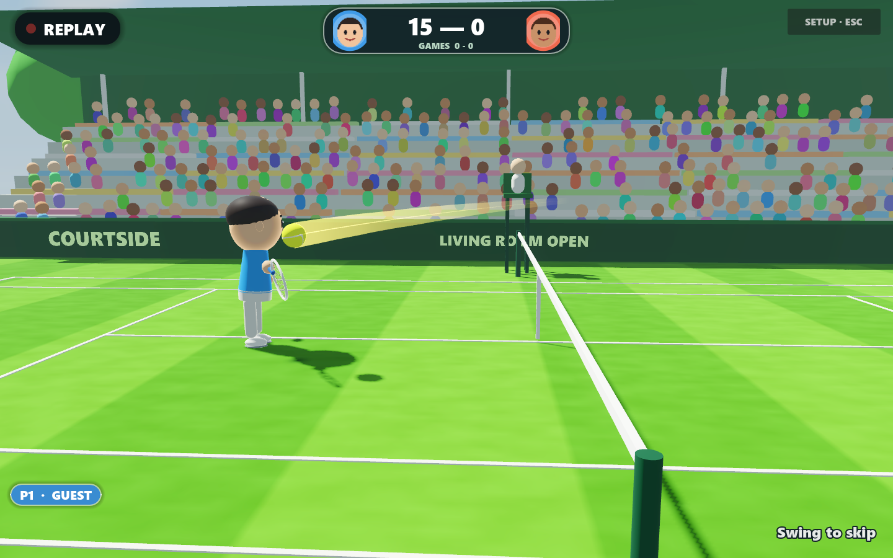
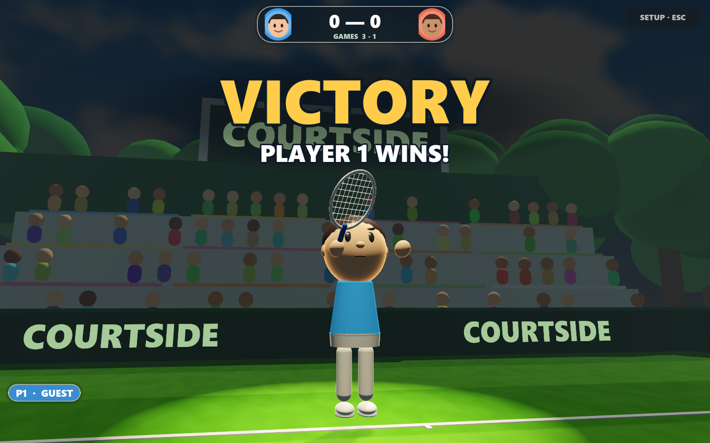

# Courtside

Courtside is a motion-controlled tennis game for Windows that uses regular Android phones as the
controllers. Hold a phone like a racket and swing it. The phone streams its gyroscope to the PC, and
the game reads the timing, direction, spin, and power of your swing. You can also prop a phone up as a
camera instead, and it tracks your body with pose estimation that runs right on the phone.

It's a solo side project and a working prototype. You can play singles against a CPU or a friend, run
practice drills, and save player profiles with photo faces and your own look. There are also instant
replays and a spotlight for whoever wins the match. Tennis is the first game for a motion console I'm
building, called MaGestic. The PC runs a home screen that pairs the phones, and each game plugs into
it.

| Instant replay | Match-win spotlight |
|---|---|
|  |  |

## Try it

Download the Windows ZIP and the Android APK from the [latest release](../../releases/latest).

1. Unzip into a new folder on a Windows PC and run `MaGestic.exe` (or `Run-MaGestic.cmd`). The
   **Tennis** tile is already selected, so click it or press Enter. You can play with just the
   keyboard, no phone needed: Q / W / E swing (slow, medium, fast), A / D aim, and the first press on
   your serve tosses the ball.
2. For motion play, install the APK on one or two Android phones (Android 8+). Put the PC and the
   phones on the same Wi-Fi, type the four-digit room code from the home screen into the phone, pick
   **Remote**, and join. Each phone gets a player automatically. The home screen shows each player's
   phone as **Ready**, and the phones stay paired when you go in and out of tennis.
3. Use a wrist strap. Seriously.

There's a Linux build too (`MaGestic-Linux.tar.gz`): unpack it and run `run-magestic.sh`. It's an
unsigned prototype, so Windows SmartScreen may ask you to confirm, and the APK installs from outside
the Play Store.

## What's in the latest version

- **Gentler shots that actually work:** a slow slice that chops down plays as a drop shot, a soft
  touch shot gets the longer timing window so it isn't called "Too early" as often, and a gentle
  upward swing at the net is a lob.
- **Your racket follows your phone.** Between swings, the racket on screen points wherever the top of
  your phone points, and it rolls with your wrist during a swing.
- **Your own look:** tap a saved player's portrait on the home screen to pick a shirt color, skin tone,
  and height, with a 3D preview. Tennis dresses your player in it.
- **Point at the menus with your phone:** aim the remote at the screen (or raise a hand in front of a
  camera phone) and hold the ring on a button for about a second to press it. This works on the home
  screen for now. Tennis's own menus come later.
- **Low graphics for older PCs:** turns off shadows, glow, and fog and draws the court at 75%
  resolution, while the score and menus stay sharp.
- **Full screen on any monitor,** with a screen picker and F11. Face photos always use the phone's
  front camera.
- **Phone app 0.23,** now called MaGestic: big boxes for the room code, simple switches for Remote or
  Camera and the player, and a small status bar once you've joined. In camera mode it shows how many
  frames a second it's tracking, and Help → **Camera speed** has three switches to try on slower
  phones.
- **If something crashes, the phones stay paired.** If tennis crashes, the home screen comes back and
  one click starts it again.

## How it works

- **Game:** Godot 4.4 (GDScript), using the GL Compatibility renderer so it runs smoothly on
  integrated laptop graphics (about 70 FPS on an Intel Iris Xe during replays).
- **Phone app:** native Android (Java). In Remote mode it streams the gyroscope at 200 Hz over UDP. In
  Camera mode it runs MediaPipe pose estimation on the phone and sends body landmarks instead of video.
- **Pairing:** the phones pair with the MaGestic home screen, not with the game, using a four-digit
  room code, UDP broadcast discovery, per-session tokens, and automatic player assignment. The home
  screen passes the phones' frames through to tennis, which added about 2 ms in a test with simulated
  phones. There's also an experimental offline mode where one phone hosts its own Wi-Fi hotspot (not
  tested on real hardware yet).
- **Swing reading:** the swing detector is tuned against recordings of real swings, not guesses. A
  replay suite re-reads 14 real recordings on every change and flags any swing that's now read worse.
- **Gameplay:** ball flight with topspin and slice, aim by timing (early pulls the ball cross-court,
  late pushes it down the line), a four-level CPU opponent, and assists for smashes and volleys.
- **Presentation:** procedurally animated players, an instant replay from a recorded frame buffer with
  slow motion on the winning shot, and a spotlight finale. The music and sound effects are all
  original: either written as note data and rendered in code, or synthesized.
- **Testing:** about 830 automated assertions for tennis (unit and swing-pipeline tests), a full-scene
  integration test over real UDP, and self-play visual checks of racket-to-ball contact.

## Status

This is a prototype. Every build is tested in software and against recorded swings, and play with real
phones gets tested in short playtest cycles. The last real-phone session was a full match against the
CPU, started from the MaGestic home screen with two paired phones. The source code is private for now.

## Credits

Built with [Godot Engine](https://godotengine.org) (MIT), the TweenFX Godot add-on (MIT), and
[Google MediaPipe](https://github.com/google-ai-edge/mediapipe) (Apache 2.0), using the Inter typeface
(SIL Open Font License). The full notices ship in the `licenses` folder of the download. All the art,
music, and sound were made for this project.
